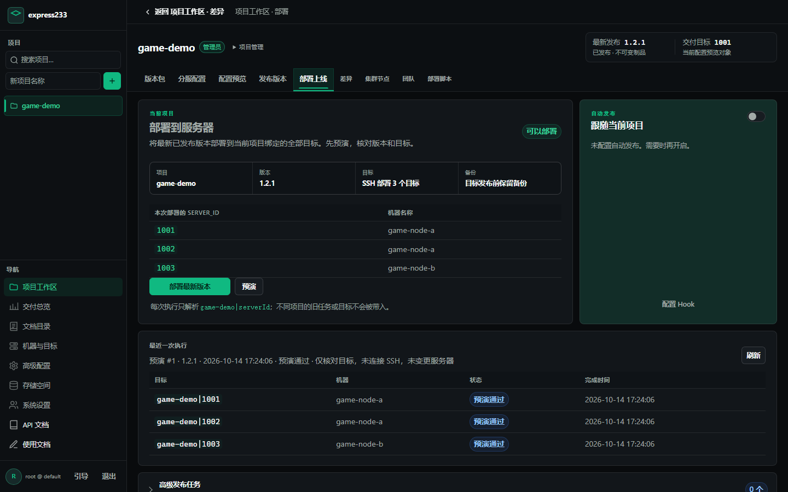
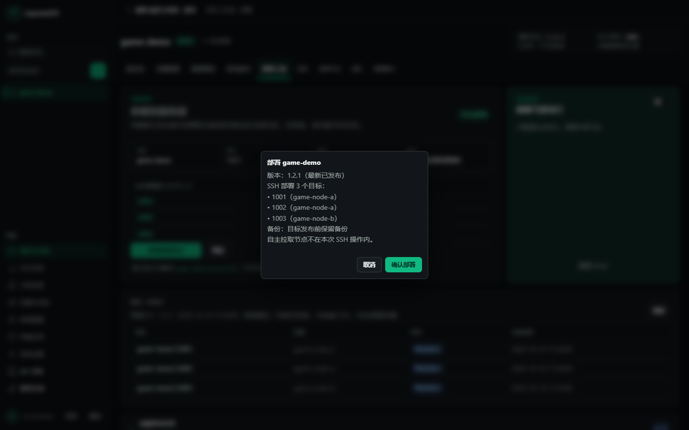
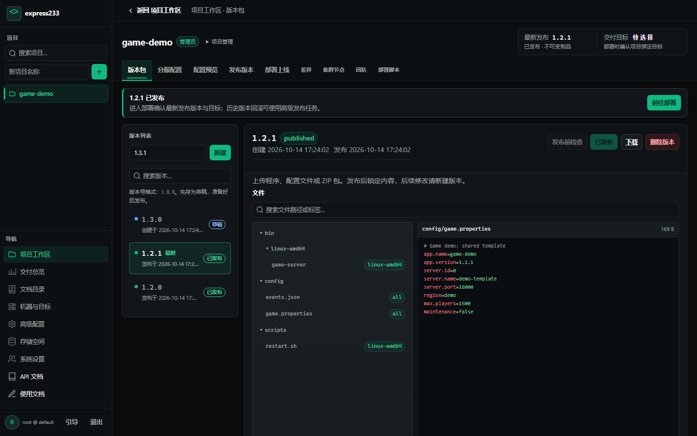
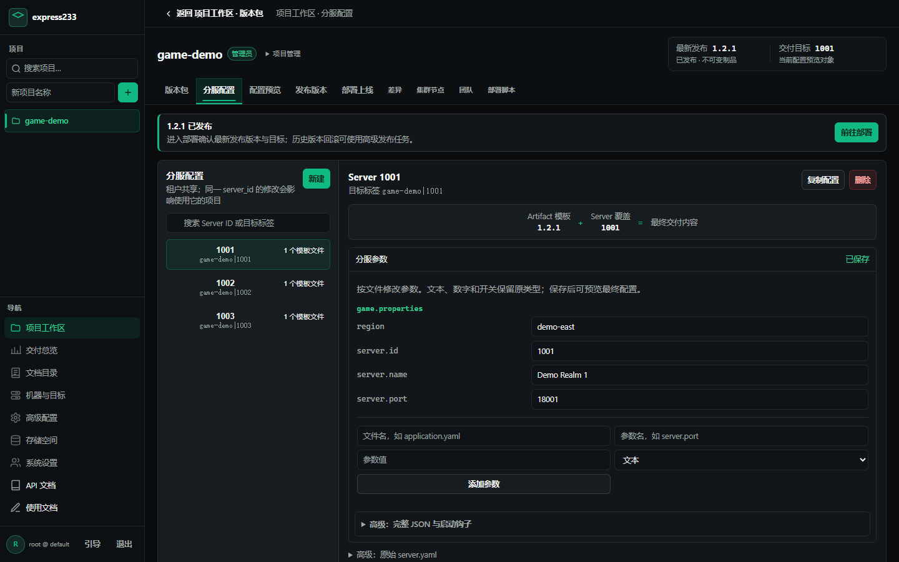
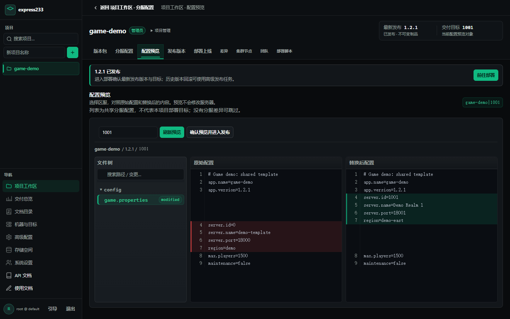
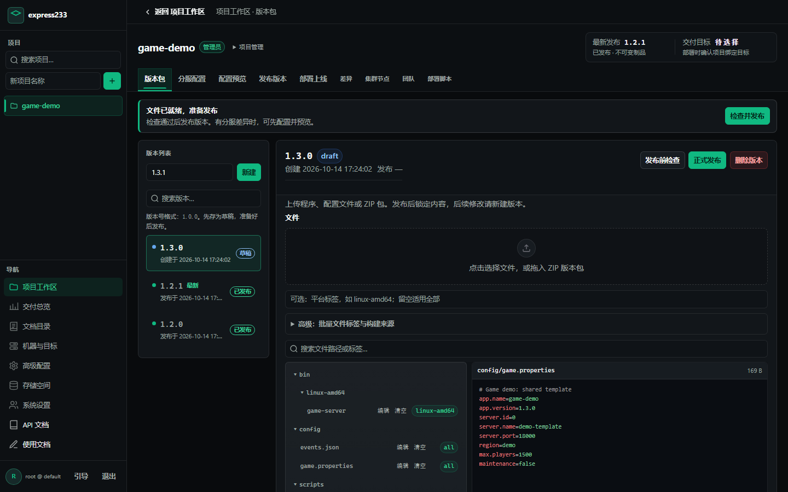
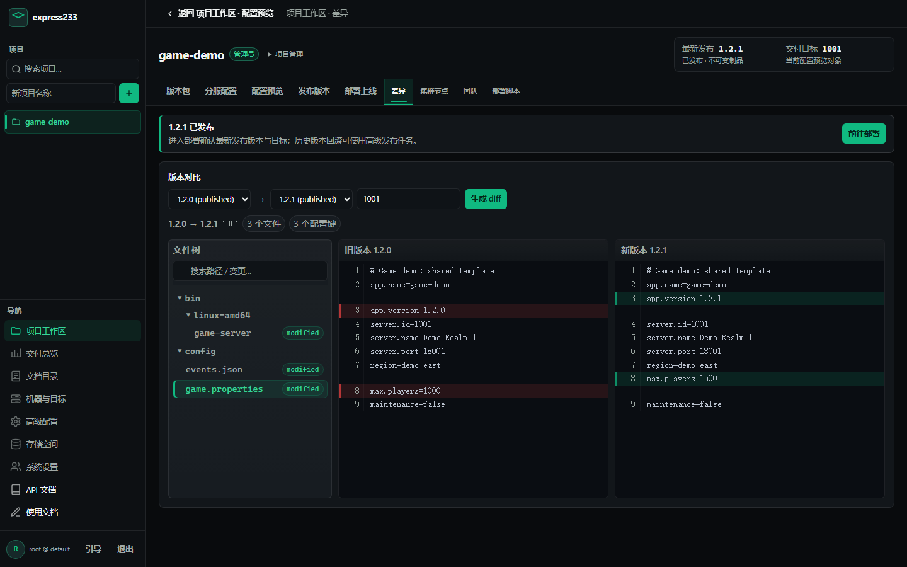
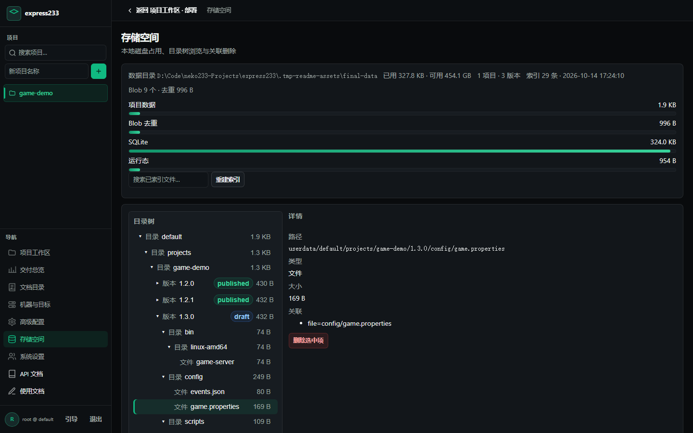

# express233

[](https://github.com/neko233-com/express233/actions/workflows/ci.yml)
[](https://github.com/neko233-com/express233/actions/workflows/lint.yml)
[](https://github.com/neko233-com/express233/releases/latest)

**面向游戏服务器的版本管理与部署控制台。** 上传一次版本包，按 `server_id` 生成各服配置，再通过 SSH 部署或 Pull Agent 拉取。适用于网关、逻辑服、战斗服及配套服务。

[下载正式版](https://github.com/neko233-com/express233/releases/latest) · [使用流程](docs/CONSOLE_WORKFLOW.md) · [完整文档](docs/README.md) · [更新记录](CHANGELOG.md)

## 界面预览

部署前直接核对项目、版本、服号、机器和备份策略；高级任务与历史记录按需展开。



确认弹窗再次列出本次 SSH 操作的具体目标，避免混淆“发布版本包”和“部署游戏服”。



<details>
<summary>查看版本管理、分服配置和配置预览</summary>

**版本管理**：草稿准备文件，发布后锁定内容。



**分服配置**：只填写不同区服需要覆盖的字段；没有差异时可跳过。



**配置预览**：对照原始配置与替换后配置，预览不会修改服务器。



</details>

<details>
<summary>查看文件标签、版本差异和存储空间</summary>







</details>

以上均为当前控制台在本地演示环境生成的真实截图，使用虚构项目和区服，不包含生产数据。生成方法见 [截图说明](.assets/README.md)。

## 从版本包到上线

| 步骤 | 在控制台做什么 | 结果 |
| --- | --- | --- |
| 1. 版本包 | 选择项目，新建 `1.0.0` 草稿，上传程序、配置或 ZIP | 文件暂存，尚未部署 |
| 2. 分服配置（可选） | 按 `server_id` 填写需要覆盖的字段 | 同一份包适配不同区服 |
| 3. 配置预览（可选） | 选择区服，对照原始内容和替换结果 | 核对实际将交付的配置 |
| 4. 发布版本 | 运行发布前检查，确认发布 | 版本内容锁定，可供交付 |
| 5. 部署上线 | 核对版本、目标清单与备份策略，再确认部署 | SSH 按目标执行，结果进入部署历史 |

**预演只核对目标，不连接 SSH、不停服，也不代表服务器已更新。** Pull Agent 自主拉取，不属于“部署最新版本”按钮的 SSH 操作范围。已开启的自动 Hook 或 Pull 自动跟随可能在版本发布后触发交付，发布前应检查这些规则。

日常操作使用“部署最新版本”；需要回滚到保留的历史版本、固定部分服号或使用标签条件时，再展开“高级发布任务”。固定版本已被删除时必须重新选择，系统不会自动替换成最新版本。完整操作见 [控制台工作流](docs/CONSOLE_WORKFLOW.md)。

## 核心能力

| 能力 | 说明 |
| --- | --- |
| 版本与来源 | 草稿、审批、发布；不可变文件与标签；Git / GitHub / Gitea 来源和构建记录 |
| 分服配置 | 按配置文件 basename 深度覆盖 YAML / JSON / properties，提供原始与渲染后预览 |
| SSH 部署 | 项目目标绑定、固定服号子集、逐服执行结果、备份策略和健康检查 |
| Pull Agent | 心跳上报当前版本，按期望版本与 generation 收敛，健康检查后确认 |
| 自动化 | HTTP API、可重复发布任务、发布 Hook、幂等请求和防抖合并 |
| 团队 | 多租户、项目邀请、`viewer` / `operator` / `admin` 权限 |
| 运维 | 发布历史、逐服日志、存储空间、Blob 去重、审计与 Prometheus 指标 |

Push 与 Pull 的职责、健康门禁和回滚边界见 [交付控制平面](docs/DELIVERY_CONTROL_PLANE.md)。

## 安装与启动

中央服使用 `express233-server`，被部署的机器使用 `express233-cli`。从 [GitHub Releases](https://github.com/neko233-com/express233/releases/latest) 下载匹配平台的二进制，也可使用安装脚本。

| 系统 | 已提供的 Release 架构 |
| --- | --- |
| Linux | amd64、arm64 |
| macOS | amd64、arm64 |
| Windows | amd64 |

每个正式版包含 10 个 CLI / Server 二进制、`SHA256SUMS` 和 `PROVENANCE.json`。校验文件使用统一的 `SHA256SUMS`，不是每个文件单独的 `.sha256`。生产安装与升级步骤见 [部署文档](docs/DEPLOY.md)。

### 中央服

Linux / macOS：

```bash
curl -fsSL https://raw.githubusercontent.com/neko233-com/express233/main/scripts/install-server.sh -o install-server.sh
bash install-server.sh
express233-server start
express233-server status
```

Windows PowerShell：

```powershell
Invoke-WebRequest https://raw.githubusercontent.com/neko233-com/express233/main/scripts/install-server.ps1 -OutFile install-server.ps1
./install-server.ps1
# 将 %LOCALAPPDATA%\express233 加入 PATH 后：
express233-server start
express233-server status
```

固定版本时，Shell 脚本接收 `bash install-server.sh vX.Y.Z`；PowerShell 脚本接收 `./install-server.ps1 -Version vX.Y.Z`。请把 `vX.Y.Z` 换成实际 Release 标签。安装脚本用于安装，不应直接覆盖正在运行的生产二进制。

默认访问 [http://127.0.0.1:23380](http://127.0.0.1:23380)。数据目录优先使用 `EXPRESS233_DATA`，否则为 `~/.express233-server`。使用管理员分配的账号登录；首次安装应先完成管理员改密并创建日常账号，再开放网络入口。

也可从源码体验：安装 Go 1.26 后运行 [run-server.cmd](run-server.cmd) 或 [run-server.sh](run-server.sh)。这些开发脚本可能停止已有本地 Express233 实例；隔离启动可使用独立端口和数据目录：

```bash
go run ./cmd/express233-server serve --addr 127.0.0.1:23381 --data .data-demo
```

### 游戏服节点

安装节点 CLI 与安全部署脚本：

```bash
curl -fsSL https://raw.githubusercontent.com/neko233-com/express233/main/scripts/install.sh -o install-cli.sh
bash install-cli.sh
```

凭据由 Secret 管理器或部署环境注入 `EXPRESS233_TOKEN`，或注入 `EXPRESS233_USERNAME` / `EXPRESS233_PASSWORD`；不要写进 Git、命令行参数或日志。以下示例只设置非敏感选项：

```bash
export EXPRESS233_SERVER=https://control.example.invalid
export EXPRESS233_PROJECT=game-demo
export GAME_ROOT=/opt/game-servers
safe-deploy.sh --server-id 1001 --version 1.0.0 --backup
```

Linux 生产部署需安装 `rsync`。安全 runner 暂存新包，校验实例进程并等待退出，再替换程序、启动及执行健康检查；`rsync` 路径保留实例的 `data/`、`logs/`、`run/`。停服超时默认中止，正常发布禁止自动强杀。详见 [安全部署及平台边界](docs/SAFE_DEPLOY.md)。

`express233-cli pull` / `deploy` 当前行为相同：直接解包到 `--dest`，默认执行 `post_hook`，只有 `--skip-hook` 才跳过。它们本身不提供完整的 stop → swap → start 隔离流程。运行中的游戏服应通过安全 runner 或控制台的 SSH 部署入口更新。

持续运行的 Pull Agent 示例：

```bash
express233-cli agent --project game-demo --server-id 1001 \
  --role logic --environment production --root /opt/game-servers --interval 1m
```

Windows 节点使用 [safe-deploy.ps1](scripts/safe-deploy.ps1)，其停进程语义与 Linux SIGTERM 不同；完整接入与适用条件见 [Pull Agent 指南](internal/api/guide/agent.md)。

## 分服配置的边界

版本包里的配置 basename 必须唯一。例如不同目录不能各有一个 `application.yaml`。配置覆盖按租户共享，同一个 `server_id` 被多个项目使用时，修改会影响这些项目的后续交付。

```yaml
servers:
  "1001":
    replacements:
      application.yaml:
        game:
          serverId: "1001"
          listenPort: 9001
  "1002":
    replacements:
      application.yaml:
        game:
          serverId: "1002"
          listenPort: 9002
```

没有分服差异可跳过覆盖字段与预览，但 Pull / Agent 仍要求先注册 `server_id`，可使用空的 `replacements`。预览下拉框列出的是共享分服配置，不等同于项目的 SSH 部署目标。`server.yaml` 不随版本包冻结，回滚时仍会使用当前配置。配置路径和 `post_hook` 约定见 [配置示例](configs/server.yaml.example) 与 [脚本契约](docs/DEPLOYMENT_SCRIPT_CONTRACT.md)。

## 运维与升级

| 命令 / 入口 | 用途 |
| --- | --- |
| `express233-server status` / `version` | 确认服务状态与运行版本 |
| `start` / `stop` / `restart` | 服务生命周期；安装原生服务后优先使用原生控制方式 |
| `port` / `set-port 32380` | 查看或修改监听地址；修改默认会重启 |
| `enable-autostart` / `autostart-status` | Linux systemd、macOS launchd、Windows 计划任务 |
| `update --version vX.Y.Z` | 中央服自更新；运行前遵循生产升级检查 |
| `reload-config` | 校验并热重载租户 `server.yaml` |
| `backup-config` / `restore-config` | 配置备份与恢复，不等同于完整数据备份 |
| 控制台“系统设置” | 日常账号、改密和审计 |
| 控制台“存储空间” | 查看占用与删除计划；删除已发布版本会影响后续拉取与回滚 |

升级中央服必须保留原 `EXPRESS233_DATA`、数据库、租户配置和服务配置。备份策略可以按运维要求决定，但不能通过清空数据目录完成升级。游戏服包备份与中央服数据备份是两件事，详见 [生产升级与数据保留](docs/DEPLOY.md)。

## 文档导航

| 需要完成的事 | 文档 |
| --- | --- |
| 第一次使用 / 日常发布 | [控制台工作流](docs/CONSOLE_WORKFLOW.md) |
| 接入 SSH 机器、绑定区服 | [SSH Push 部署](docs/SSH_PUSH_DEPLOY.md) |
| 规划 Push / Pull 与多服拓扑 | [交付控制平面](docs/DELIVERY_CONTROL_PLANE.md) |
| 停服、换包、健康检查与回滚 | [安全部署](docs/SAFE_DEPLOY.md) · [脚本契约](docs/DEPLOYMENT_SCRIPT_CONTRACT.md) |
| 安装、Docker / K8s、升级 | [部署文档](docs/DEPLOY.md) |
| CI 上传、发布及自动化 | [HTTP 示例](docs/HTTP_AUTOMATION_DEMO.md) · [Gitea](docs/GITEA_PRODUCTION.md) · [GitHub Actions](docs/GITHUB_ACTIONS.md) |
| 标签、平台和架构过滤 | [文件标签](docs/FILE_TAGS.md) |
| Cloudflare 入口 | [Cloudflare](docs/CLOUDFLARE.md) |
| API 与内置帮助 | [OpenAPI](docs/openapi.yaml) · [静态指南](internal/api/guide/overview.md) |

运行中的中央服在 `/docs/` 提供 Swagger UI，在 `/api/agent/guide` 提供只读、脱敏的内置指南。全部入口与维护约定见 [文档目录](docs/README.md)。

## 开发与发布

工具链为 Go 1.26、Node.js 24 LTS（浏览器测试）和 golangci-lint v2。

```bash
go test ./...
golangci-lint run --timeout=5m
# 浏览器验收是独立流程：
cd test/visual
npm ci
npx playwright install chromium
npm test
```

本地脚本包括 [build-all.cmd](build-all.cmd) / [build-all.sh](build-all.sh)、[visual-e2e.cmd](visual-e2e.cmd) / [visual-e2e.sh](visual-e2e.sh)。开发脚本启用 `EXPRESS233_WEB_DIR=internal/api/web` 后，静态页面修改可通过刷新查看。

只有目标 commit 的 `golangci-lint`、三平台 `test`、`build binaries`、`validate scripts` 全部成功，才能推送发布标签。Release 工作流会再次检查；浏览器测试独立运行，不代替发布门禁或真实游戏服验收。详见 [GitHub Actions](docs/GITHUB_ACTIONS.md) 与 [AGENTS.md](AGENTS.md)。

MIT License，见 [LICENSE](LICENSE)。
